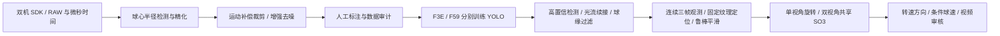

# PingPong

[](https://github.com/yuhaoyan04/PingPong/actions/workflows/tests.yml)

双事件相机乒乓球系统，重点估计**球的转速和方向**，同时提供条件球速、标记轨迹与逐帧审核视频。项目整合相机 SDK、RAW 采集、球体运动补偿、分相机增强与去噪、标注、两套 YOLO 训练、标记追踪和离线旋转求解。



已跑通现有数据的离线链路，并核对实际发球 RAW 的 5.475 亿个事件及参考画面的时间映射。**当前输出仍是条件转速候选**：双机物理同步、实测空间标定和独立转速真值尚未完整验证。相机坐标中的方向不能直接当作球桌坐标的上旋、下旋或侧旋。

## 安装与测试

CPU 回归测试不需要相机、CUDA、模型权重或私有数据。CI 覆盖 Python 3.10、3.12；当前固定的 Numba 依赖要求 Python <3.13。

```bash
git clone https://github.com/yuhaoyan04/PingPong.git
cd PingPong
python3.12 -m venv .venv
source .venv/bin/activate
python -m pip install -r requirements-test.txt
QT_QPA_PLATFORM=offscreen python -m pytest -q
python pingpong.py doctor
```

Linux 需安装 FFmpeg；无桌面环境的 GUI 测试使用 `QT_QPA_PLATFORM=offscreen`。Ubuntu 的系统库安装命令见 [CI 配置](.github/workflows/tests.yml)。Windows 可使用 `.venv\Scripts\python.exe pingpong.py ...`；GUI 标注需要图形会话。

训练和 YOLO 推理还需按 [训练依赖](requirements-yolo.txt) 准备匹配硬件的 PyTorch/CUDA，并安装 `python -m pip install -e '.[yolo,review]'`。相机连接与官方 wheel 版本见 [SDK 说明](docs/hardware/CAMERA_SDK.md)。CPU 测试环境不会安装或升级 CUDA 组件。

## 数据与运行

Git 仓库包含代码、配置、测试、SDK 资料和算法说明。RAW、标注数据、模型、实验记录及生成的视频由本地维护，**不会随克隆下载**。

| 本地资产 | 默认位置 |
| --- | --- |
| 最新双相机数据包 | `data/server_marker_two_camera_train_v1/` |
| 实际发球 RAW | `data/master_DSP01F1FFF3E.raw`、`data/slave_DSP01F1FFF59.raw` |
| 生产模型与训练完成记录 | `experiments/two_camera_v1/{F3E,F59}/`，模型为 `train/weights/last.pt` |
| 冻结检测缓存（后处理重放使用） | `experiments/two_camera_v1/{F3E,F59}/qualitative/` |
| 当前视频审核入口 | `output/latest_observations/review.html` |
| 球几何重建及历史数值对照 | 参见 [追踪续接说明](docs/TRACK_CONTINUITY.md) |

先运行 `doctor` 检查本机资产。`PINGPONG_DATASET`、`PINGPONG_EXPERIMENT` 可指定数据包和训练目录；新数据必须符合源清单与审计规则。

```bash
# 所有环节均可查看参数
python pingpong.py run capture --help
python pingpong.py run ball-track --help
python pingpong.py run annotate --help
python pingpong.py run train --help

# 已准备数据与模型：重新推理、追踪、筛选并生成离线审核
python pingpong.py pipeline --camera all --device 0 --output output/pipeline_new

# 已有连续观测：只重新求解转速
python pingpong.py spin --tracks /path/to/rotation_tracks.csv \
  --dataset /path/to/dataset --output output/spin_new

# 已有几何和冻结检测缓存：迭代追踪与组合优化
python pingpong.py run refine-continuity --output output/continuity_new
python pingpong.py run review-observations \
  --source output/continuity_new --output output/continuity_new
```

采集、标注、导出、训练的完整参数与前置资产见 [统一工作流](docs/UNIFIED_WORKFLOW.md)。新建训练使用独立实验目录，避免覆盖已完成模型。无源 manifest 的假设帧率预览不能作为可信转速输入。

## 算法与审核

- [serve05 缺失原因与追踪续接](docs/TRACK_CONTINUITY.md)：两个高置信命中确认、短期漏检续接、连续三帧筛选、有效重叠窗口覆盖。
- [标记中心、球心与半径优化](docs/OBSERVATION_REFINEMENT.md)：固定纹理定位、RAW 边界圆测量、连续几何模型及失败回退。
- [轨迹平滑与转速公式](docs/MARKER_TRAJECTORY_SMOOTHING.md)、[离线旋转求解](docs/OFFLINE_MARKER_SPIN.md)。
- [两视角联合模型](docs/SERVE_TWO_VIEW_SPIN.md)、[独立转速、总转速与局部方向](docs/SPIN_DIRECTION_REVIEW.md)。
- [事件时间核验](docs/BALL_RAW_VALIDATION.md)、[双机裁剪时间对齐](docs/CLIP_SYNC_AUDIT.md)、[全链路实验记录](docs/SYSTEM_ITERATION.md)。
- [开发、结果缓存与自动测试](docs/DEVELOPMENT.md)。

审核只保留原始、球心/半径优化、组合优化三组。画面分别显示 F3E、F59 独立转速和注明来源的系统总转速；预测保持点不参与旋转拟合，缺少当前观测时不沿用旧值。连续三帧是轨迹导出下限，拟合仍需满足时间跨度、几何和残差条件。

最新服务器结果保存在 `output/latest_observations/`，用本机浏览器打开 `review.html`，或下载该目录的 `spin_review_bundle.zip` 后解压查看。GitHub 首页不会包含这些本地视频。

## 代码目录

| 路径 | 职责 |
| --- | --- |
| `src/pingpong_event_pipeline/` | 采集、事件时间、球体与标记算法、旋转、运动分析和结果校验 |
| `tools/`、`tools/yolo/` | SDK、数据、训练、推理与审核命令 |
| `config/`、`configs/` | 相机、增强、追踪与转速配置 |
| `tests/`、`tools/yolo/test_*.py` | 合成真值、输入契约、追踪和输出恢复回归测试 |
| `third_party/`、`docs/hardware/` | 官方 SDK 资料及使用文档 |

历史 Windows 工具和路径说明保存在 [上游工作流](docs/UPSTREAM_WORKFLOW.md)、[工具索引](docs/TOOL_INDEX.md)。当前数据覆盖有限，尚无完整独立标注测试集，不据此发布检测或物理转速准确率。
