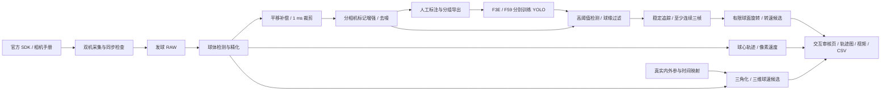

# SDK 合并后的运动分析闭环

本地分支 `integrate-yolo-offline-spin` 已将上一轮集成保存为 `7bd10d4`，再与上游 `3f08a83` 合并为 `dbe6d07`。没有推送远程；原数据和两套模型继续保留。



当前实际执行路径：已上传样本裁剪 → 现有模型重新推理 → 追踪与连续段筛选 → 鲁棒曲线平滑 → 转速估计 → 球心速度 → 统一可视化。实际发球 RAW 已上传，5.475 亿个事件与独立 EVT3 解码序列一致，旧参考画面与 RAW 的时间映射已核实；细节见 `BALL_RAW_VALIDATION.md`。这不证明双机物理同步或空间标定完成，原 v3 输出作为历史快照保留。全链路迭代结果见 `SYSTEM_ITERATION.md`。

## 一条命令运行

```bash
cd /data2/songxinshuai/yanyh/PingPong
bash scripts/pingpong.sh doctor
bash scripts/pingpong.sh pipeline --camera all --device 1 --output output/pipeline_new
```

与 `offline` 为同一入口。使用已经训练完成的权重，不重复 150 epoch 训练。默认重新运行模型，不重放检测缓存。结束后打开 `output/pipeline_new/motion/review.html`，结果包含：

- 每个相机/发球一份四联轨迹和曲线 PNG，共 14 组。
- 每组同步展示标记 ID/轨迹、球心原图位置、像素速度和转速候选的 MP4。
- 可切换组别和时间滑块的独立 HTML；无需网络、CDN 或服务器。视频为 25 FPS 慢放，时间标签使用原始事件微秒。
- `ball_motion.csv`：球心、半径、像素速度、球径归一化速度及条件性的横向 m/s。
- `marker_tracks_sensor.csv`：按源球心、半径和裁剪倍率还原至传感器坐标的标记轨迹。
- `group_summary.csv`、`motion_report.json`：分组统计、输入哈希、SDK 验证范围、缺失标定与测量限制。
- `stereo_motion.csv`：有真实标定才生成三维样本；缺少标定时只保留表头，不伪造三维点或速度。

只为既有追踪结果生成报告，无须重新运行模型：

```bash
bash scripts/pingpong.sh motion \
  --tracking output/latest/tracking \
  --spin-report output/latest/spin/spin_report.json \
  --output output/motion_new
```

`--no-videos` 可只输出 HTML、PNG、CSV。HTML 同目录资源需要一并复制；转速详情链接位于同一次运行的 `spin/` 子目录。

## 速度的计算与单位

在原始传感器坐标中，按源微秒时间戳对球心做局部稳健多项式求导。只使用圆周支持的球体样本；回退帧、缺帧和时间间隔超过 750 μs 时断开，不跨缺口求导。默认求导窗口 5 ms，不对标记的球面转动误当作整球平移。

`image_speed_px_s = sqrt(vx_px_s² + vy_px_s²)`。

`projected_speed_ball_diameters_s = image_speed_px_s / (2 × radius_px)`。

`candidate_transverse_speed_mps = projected_speed_ball_diameters_s × ball_diameter_m`，默认假设直径 0.040 m，可通过 `--ball-diameter-m` 修改。

最后一项是局部弱透视和指定球径下的投影速度估计，缺少沿视线方向的运动，也依赖球心/半径估计，不能当作真实三维球速。正式字段 `speed_mps` 继续为空。转速同样输出候选 RPM，正式 `spin_rpm` 为空，见 `OFFLINE_MARKER_SPIN.md`。

## 提供真实标定后

标定 NPZ 使用项目 `StereoCalibration` 的 K1、D1、K2、D2、R、T、P1、P2、F（及可选 R1/R2）格式，T 的单位必须为米。必须显式说明 K1 是哪一台相机，不根据当前主从记录猜测历史标定方向。

```bash
bash scripts/pingpong.sh motion \
  --tracking output/latest/tracking \
  --spin-report output/latest/spin/spin_report.json \
  --calibration calibration/stereo_calibration.npz --master-camera F59 \
  --slave-offset-us 0 --output output/calibrated_motion_new
```

时间校正量**加到从机时间戳上**。只在相邻有效支持样本之间短距离插值，经过极线、正深度和重投影检查后三角化；速度求导同样不跨缺口。生成 `candidate_3d_speed_mps` 和三维轨迹图，仍需独立真值验证。测试中的合成标定仅用于验证算法，从不代替真实输入产生用户测量结果。

## 复核优先级

先审球心/半径与裁剪抖动，再审簇内中心和身份匹配；提供发球 RAW、真实内外参以及对应采集时间证据后，连接透视球面和双目求解。最后使用已知转速/球速参考独立评估误差与覆盖率，不能仅凭低拟合残差声称精度。
